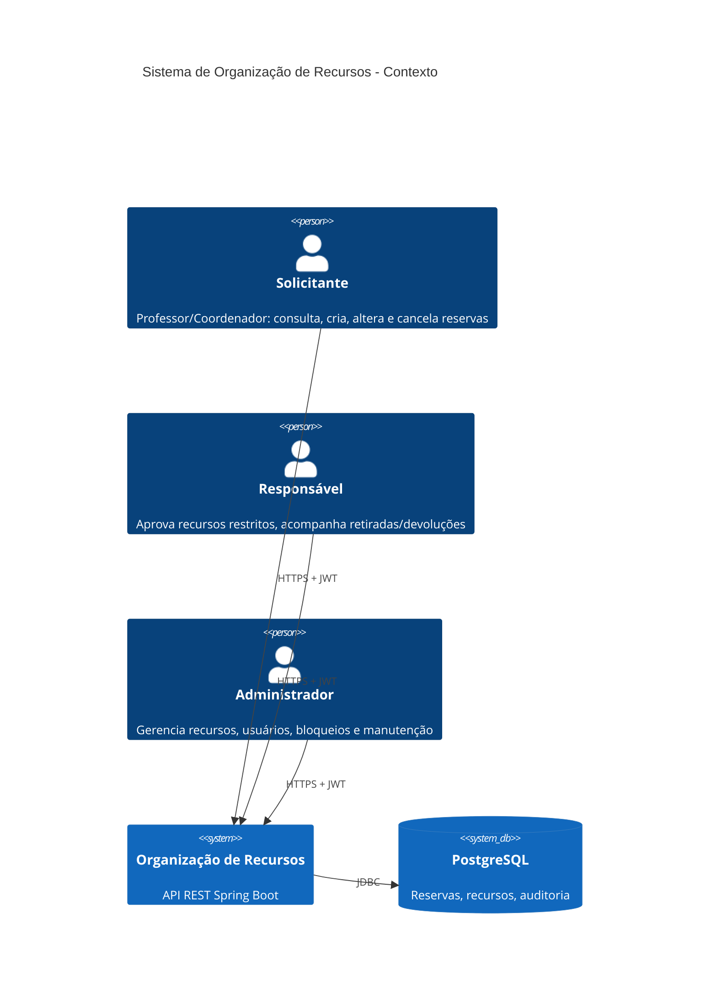
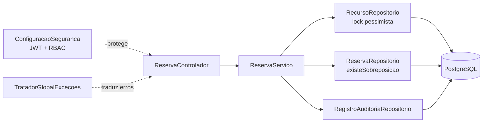
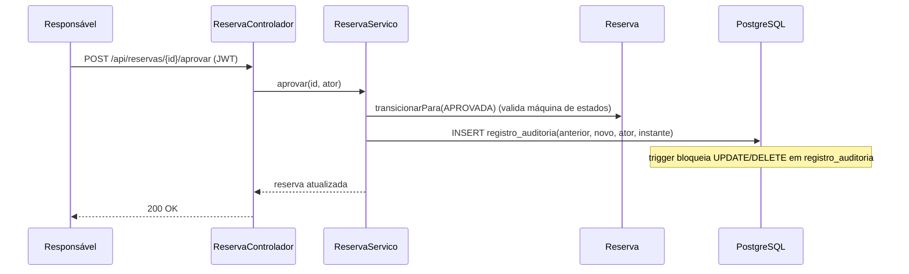

# Arquitetura (C4 em Mermaid)

## Nível 1: Contexto



## Nível 2: Componentes



## Sequência: criação concorrente (RN-03)

```mermaid
sequenceDiagram
  participant A as Requisição A
  participant B as Requisição B
  participant S as ReservaServico
  participant BD as PostgreSQL
  A->>S: criar(recurso X, 10h-11h)
  B->>S: criar(recurso X, 10h-11h)
  S->>BD: A: SELECT recurso X FOR UPDATE (obtém lock)
  S->>BD: B: SELECT recurso X FOR UPDATE (aguarda)
  S->>BD: A: existeSobreposicao? não -> INSERT reserva + registro_auditoria
  BD-->>S: A: COMMIT (libera lock)
  S->>BD: B: lock obtido; existeSobreposicao? sim
  S-->>B: ConflitoException -> HTTP 409
  Note over BD: Rede de segurança: EXCLUDE USING gist rejeita<br/>qualquer INSERT sobreposto mesmo fora do serviço
```

## Sequência: transição de estado com auditoria (RN-07)



## Decisões de design
- **Recurso unificado**: sala, professor e material são `Recurso` com `TipoRecurso`; a mesma regra de sobreposição vale para os três.
- **Defesa em profundidade**: cada regra crítica existe na aplicação e no banco (CHECK, EXCLUDE gist, triggers).
- **Auditoria sem FK**: o histórico sobrevive à remoção de reservas ainda não iniciadas.
