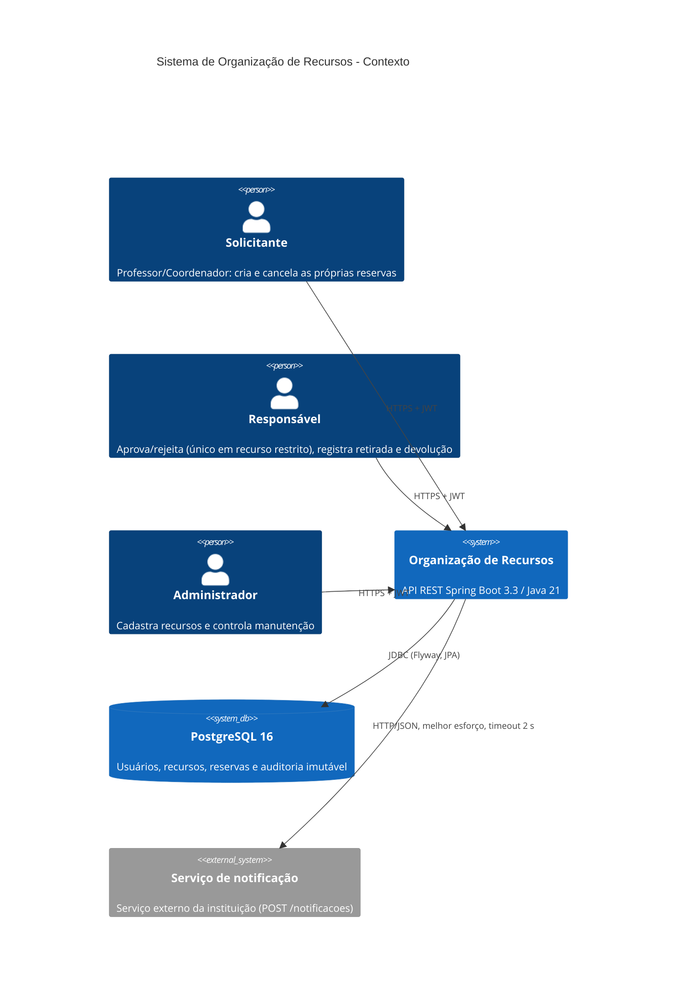
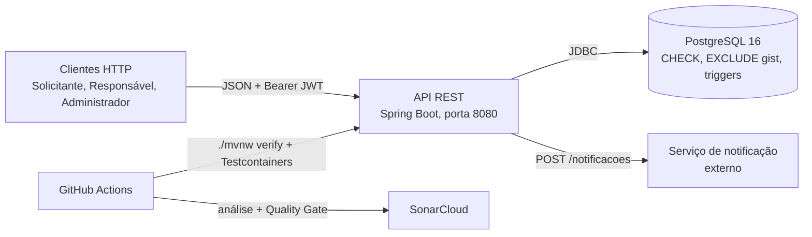
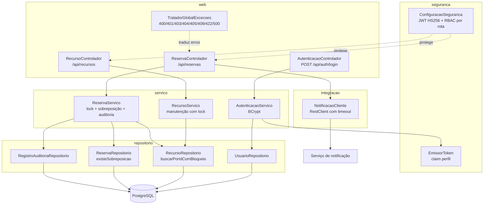
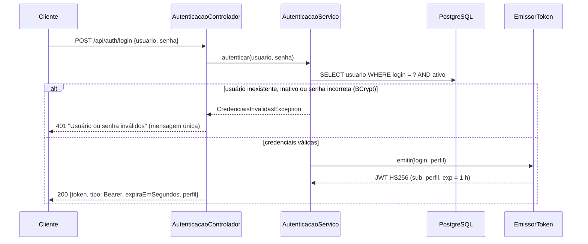
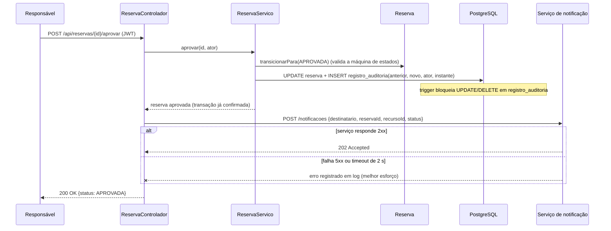
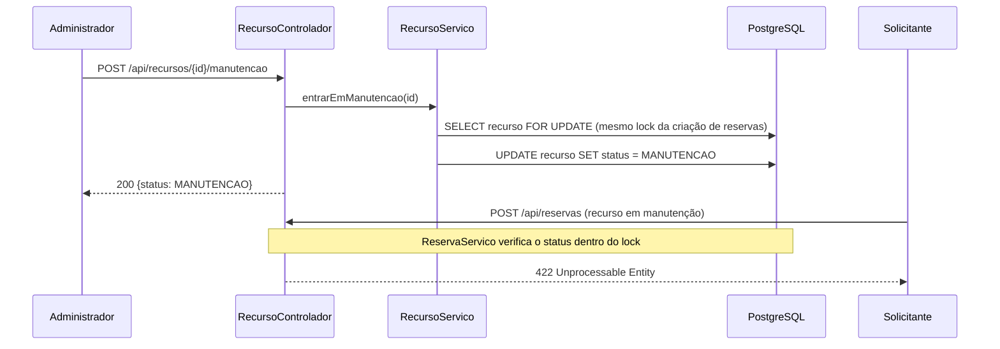

# Arquitetura (C4 em Mermaid)

Diagramas da versão `v1.0.0-rc1`. O GitHub renderiza os blocos Mermaid diretamente nesta página.

## Nível 1: Contexto



## Nível 2: Contêineres



## Nível 3: Componentes da API



## Sequência: login e emissão do JWT



## Sequência: criação concorrente (RN-03)

```mermaid
sequenceDiagram
  participant A as Requisição A
  participant B as Requisição B
  participant S as ReservaServico
  participant BD as PostgreSQL
  A->>S: criar(recurso X, 10h-11h)
  B->>S: criar(recurso X, 10h-11h)
  S->>BD: A: SELECT recurso X FOR UPDATE (obtém o lock)
  S->>BD: B: SELECT recurso X FOR UPDATE (aguarda)
  S->>BD: A: em manutenção? não. Sobreposição? não. INSERT reserva + registro_auditoria
  BD-->>S: A: COMMIT (libera o lock)
  S-->>A: 201 Created
  S->>BD: B: lock obtido; sobreposição? sim
  S-->>B: ConflitoException -> 409 Conflict
  Note over BD: Rede de segurança: EXCLUDE USING gist rejeita<br/>qualquer INSERT sobreposto, mesmo fora do serviço
```

Evidências: `ReservaConcorrenciaIT` (12 threads) e teste de carga JMeter com 50 requisições simultâneas, com resultado 1 × 201 e 49 × 409 (`docs/performance/resultado-01.md`).

## Sequência: transição de estado com auditoria e notificação (RN-07)



## Sequência: manutenção de recurso (RN-04)



## Decisões de design

- **Recurso unificado:** sala, professor e material são `Recurso` com `TipoRecurso`. A mesma regra de sobreposição vale para os três.
- **Defesa em profundidade:** cada regra crítica existe na aplicação e no banco (CHECK de período, EXCLUDE gist, triggers de exclusão e de auditoria).
- **Mesmo lock para reserva e manutenção:** reserva e entrada em manutenção do mesmo recurso nunca se cruzam.
- **Auditoria sem FK:** o histórico sobrevive à remoção de reservas ainda não iniciadas.
- **Notificação após o commit e em melhor esforço:** falha ou lentidão do serviço externo não desfaz decisões gravadas.
- **Emissão do token isolada (`EmissorToken`):** a regra de autenticação não conhece detalhes de JWT, resultado do refactor do TDD.
